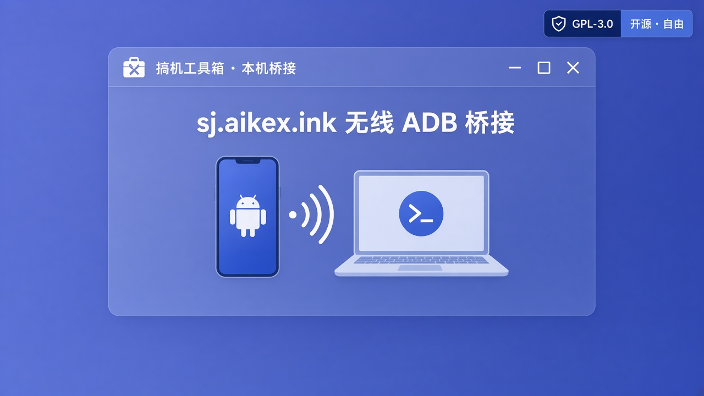
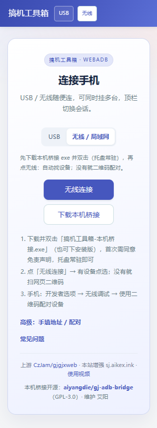
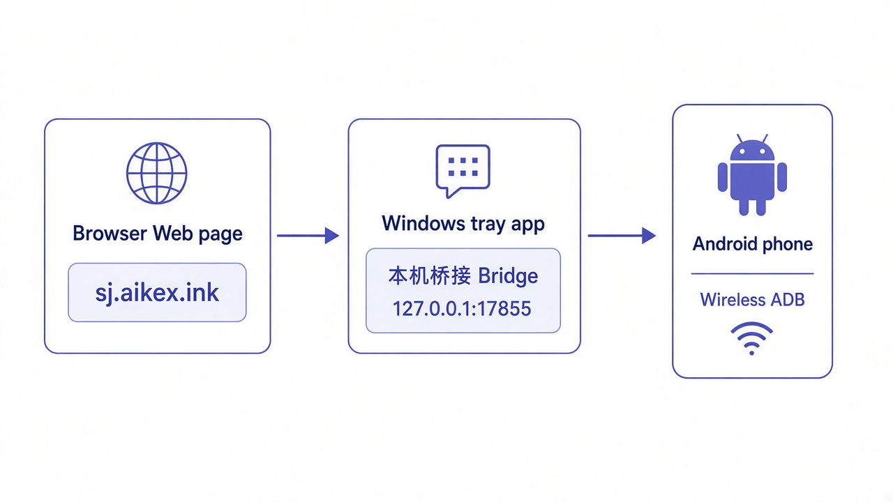

# 搞机工具箱 · 本机桥接

<p align="center">
  
</p>

<p align="center">
  <a href="https://sj.aikex.ink/"><strong>sj.aikex.ink</strong></a>
  · GPL-3.0
  · Windows 托盘小工具
  · v1.7.0
</p>

<p align="center">
  作者 <strong>艾阳</strong>
  · <a href="https://github.com/aiyangdie">@aiyangdie</a>
  · <a href="mailto:aike1015@qq.com">aike1015@qq.com</a>
</p>

浏览器没法直接连局域网里的手机（没有原始 TCP）。无线调试时，在 Windows 上跑这个很小的托盘程序：把网页 WebSocket 转成本机 ADB。

---

## 截图

| 网站无线连接 | 架构示意 |
|:---:|:---:|
|  |  |

---

## 一分钟上手

1. 打开 **[https://sj.aikex.ink/](https://sj.aikex.ink/)** → 点「下载本机桥接」
2. 任选其一：
   - **便携版** `搞机工具箱-本机桥接.exe`（或仓库 `release/gj-adb-bridge-portable.exe`）双击即用
   - **安装版** `搞机工具箱-本机桥接-安装程序.exe`（开始菜单 / 桌面快捷方式）
3. 首次必须点「同意」免责声明，否则程序直接退出
4. 托盘常驻后，回网站点「无线连接」

需要本机已有 Android `platform-tools`（`adb.exe`）。程序会自动找常见 SDK 路径。

---

## 它做什么

```
浏览器 (sj.aikex.ink)
        │  WebSocket
        ▼
本机桥接 127.0.0.1:17855   ← 本仓库
        │  ADB / TCP
        ▼
手机无线调试
```

- 只监听 `127.0.0.1`（默认端口 **17855**），不对外网开端口
- 靛蓝品牌 UI，与网站同款
- 强制免责声明门禁（不同意即退出）
- 托盘常驻、一键打开网站
- 配合网站做二维码无线配对
- 便携版 + 安装版双产物

网站侧还会：无线 shell **并发队列**（防卡死）、镜像无画面时 **自动降到 800p / 4Mbps** 重试。

---

## USB 还是无线？

| | USB | 无线 + 本桥接 |
|--|--|--|
| 是否需要本 exe | 否 | **是** |
| 连上后功能 | 相同 | 相同 |
| 稳定性 | 通常更稳 | 依赖 Wi‑Fi |

---

## 自己编译（Windows）

依赖系统自带 .NET Framework 4.x（`csc.exe`），**不用** Visual Studio。

```powershell
powershell -ExecutionPolicy Bypass -File .\build.ps1
```

产物在 `dist/`：

| 文件 | 说明 |
|--|--|
| `搞机工具箱-本机桥接.exe` | 便携版 |
| `搞机工具箱-本机桥接-安装程序.exe` | 安装版（同二进制，靠文件名进安装向导） |
| `gj-adb-bridge.exe` | ASCII 文件名副本 |

预编译包也在 [`release/`](release/)：

- `gj-adb-bridge-portable.exe`
- `gj-adb-bridge-setup.exe`

---

## 仓库结构

```
├── Program.cs / MainForm.cs / BridgeHost.cs …
├── build.ps1
├── release/          # 预编译
├── docs/screenshots/ # README 配图
└── LICENSE           # GPL-3.0
```

---

## 上游与致谢

- 网站 UI 增强基于 [CzJam/gjgjxweb](https://github.com/CzJam/gjgjxweb)（GPL-3.0）
- ADB 引擎使用 [yume-chan/ya-webadb](https://github.com/yume-chan/ya-webadb) 生态
- 本站维护与本桥接开源：[sj.aikex.ink](https://sj.aikex.ink/) · [aiyangdie/gj-adb-bridge](https://github.com/aiyangdie/gj-adb-bridge)

---

## 免责声明（摘要）

本软件按「现状」提供。请仅在你拥有或已获授权的设备上使用；无线调试 / 卸载 / 清数据等操作有数据丢失风险，请自行备份。继续使用即表示同意完整免责说明（见程序内弹窗）。

---

## 反馈

- Issues：本仓库
- 邮箱：`aike1015@qq.com`
- 作者：[@aiyangdie](https://github.com/aiyangdie)
